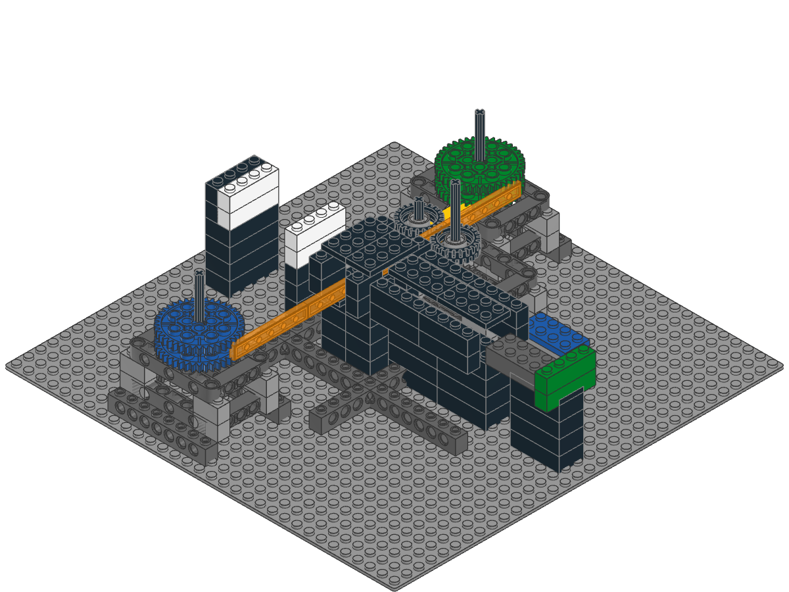

# DIY Technic Standard 8mm Telecine Film Scanner

A solderless, frame-by-frame Standard 8mm (Regular 8) film scanner built with compatible LEGO Technic bricks, a Raspberry Pi 4/5 + 12.3 MP HQ Camera (IMX477), a 35mm C-mount macro lens, and a 28BYJ-48 stepper motor with OpenCV sprocket-hole alignment.

## Documentation & Build Guides
- **[Project Specification](PROJECT_SPEC.md)** — Optical architecture, hardware BOM, and software goals.
- **[Shopping List (Canada / AliExpress)](docs/shopping_list.md)** — Full parts list with Canadian distributors, links, subtotals, and CAD estimates.
- **[Interactive 3D LEGO Build Booklet](docs/lego_instructions.html)** — 12-step page-by-page build instructions with LeoCAD 3D isometric renders and per-step parts boxes.
- **[Printable LEGO Build Guide](docs/lego_build_guide.md)** — Master BrickLink part IDs and 4-Bag / 12-step instructions.
- **[Flatbed Geometric Blueprint](docs/flatbed_blueprint.html)** — Exact Top-Down & Side-View SVG layout.
- **[ULN2003 GPIO Wiring Guide](docs/wiring.md)** — Solderless Raspberry Pi 4/5 pinout (`BCM 17, 27, 22, 23`), power guidance, and `gpiozero` bench test.

## 3D CAD & Software
- **[`cad/telecine_flatbed.ldr`](cad/telecine_flatbed.ldr)** — Stud-accurate 12-step LDraw 3D model (open with `leocad -l /usr/share/ldraw cad/telecine_flatbed.ldr` or BrickLink Studio).
- **[`src/generate_ldraw.py`](src/generate_ldraw.py)** — Python generator for the 12-step LDraw model.
- **[`src/scanner.py`](src/scanner.py)** — Raspberry Pi `picamera2` + OpenCV sprocket-hole detection and 12-bit DNG capture controller (`--calibrate`, `--dry-run`, `--show-debug`).
