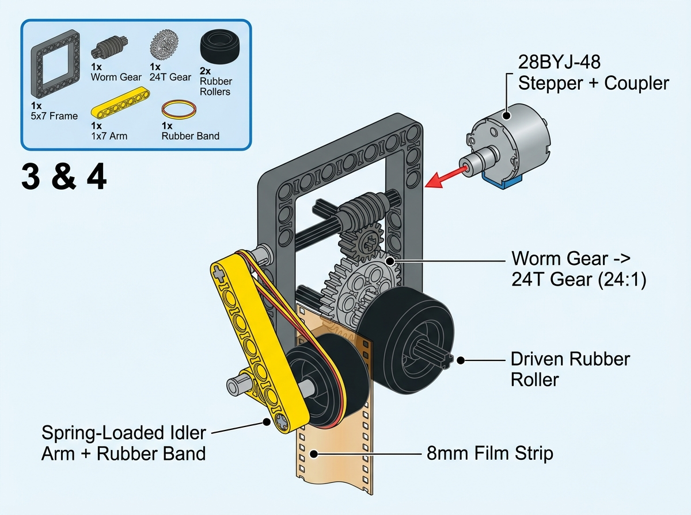

# LEGO Technic Build Guide — Flatbed Standard 8mm Telecine Scanner

This manual uses a **Flatbed Layout** (like a Steenbeck film editor or reel-to-reel tape deck): both 8mm reels lie **flat (horizontal)** on vertical Technic axles anchored to the baseplate. The film travels in **one straight horizontal line** on its 8mm edge—never twisting, never sagging, and never crossing under the LED or lens.

> **Interactive Step-by-Step LEGO Booklet:** Open [lego_instructions.html](lego_instructions.html) (press `Ctrl+Shift+B` in VSCodium to launch in Brave) to flip through all 12 stud-grid build steps one page at a time! Also see [flatbed_blueprint.html](flatbed_blueprint.html) for the full Top-Down & Side-View overview.

---

## Master Parts List (Exact LEGO / BrickLink IDs)

### Bag 1 — Baseplate & Horizontal Reel Turntables
| Qty | Part ID | Part Name | Color |
| :---: | :---: | :--- | :--- |
| 1 | `3811` *(or `4186`)* | Baseplate 32×32 *(or 48×48)* | Gray / Black |
| 4 | `3703` | Technic Brick 1×16 with Holes | Black / Gray |
| 5 | `3738` | Technic Plate 2×8 with Holes *(replaces 5 of the 5×7 frames!)* | Dark Bluish Gray |
| 1 | `64179` | Technic Liftarm Frame 5×7 Open Center *(only 1 needed — for the gearbox!)* | Dark Bluish Gray |
| 16 | `3003` | Brick 2×2 *(sturdy stud-snapped risers for reel & gearbox pedestals)* | Light Gray |
| 2 | `3737` | Technic Axle 10L *(vertical Supply & Take-Up spindles)* | Black |
| 12 | `3713` | Technic Bush (1L) | Light Gray |
| 6 | `4265c` | Technic Bush ½ Smooth | Light Gray |
| 8 | `2780` | Technic Pin with Friction Ridges | Black |

### Bag 2 — Worm-Gear Gearbox & Spring-Loaded Pinch Rollers
| Qty | Part ID | Part Name | Color |
| :---: | :---: | :--- | :--- |
| 1 | `4716` | Technic Gear Worm Screw (2L) | Dark Bluish Gray |
| 1 | `3648` | Technic Gear 24-Tooth | Dark Bluish Gray |
| 2 | `4185` | Technic Wedge Belt Wheel (Pulley) | Any |
| 2 | `56902` + `50945` | Smooth Rubber Tire (~14–24mm) + Axle-Hole Wheel | Black Tire |
| 1 | `3737` | Technic Axle 10L *(vertical Driven Pinch Roller shaft)* | Black |
| 1 | `3706` | Technic Axle 6L *(horizontal Worm Gear shaft)* | Black |
| 1 | `3705` | Technic Axle 4L *(vertical Idler Pinch Roller shaft)* | Black |
| 2 | `32524` | Technic Liftarm 1×7 Thick *(pivoting spring arm)* | Yellow / Any |
| 2 | `3673` | Technic Pin *without* Friction *(arm pivot)* | Light Gray |
| 4 | `3701` | Technic Brick 1×4 with Holes *(motor cradle)* | Black / Gray |
| 3 | — | Small Rubber Bands (#16 or LEGO silicone) | Any |
| 1 | — | 5mm Double-D to Technic Axle Coupler + 2× Zip-ties | — |

### Bag 3 — Smooth-Tile Film Gate, Diffuser & Light Tunnel (All Black)
| Qty | Part ID | Part Name | Color |
| :---: | :---: | :--- | :--- |
| 8 | `2431` | Tile 1×4 (Smooth, Studless) | **Black** |
| 4 | `6636` | Tile 1×6 (Smooth, Studless) | **Black** |
| 24 | `3001` | Brick 2×4 | **Black** |
| 16 | `3004` | Brick 1×2 | **Black** |
| 12 | `3010` | Brick 1×4 | **Black** |
| 16 | `3020` | Plate 2×4 | **Black** |
| 12 | `3023` | Plate 1×2 | **Black** |

### Bag 4 — HQ Camera & LED Cradles
| Qty | Part ID | Part Name | Color |
| :---: | :---: | :--- | :--- |
| 4 | `3701` | Technic Brick 1×4 with Holes | Black |
| 4 | `32316` | Technic Liftarm 1×5 Thick | Black / Gray |
| 8 | `3020` | Plate 2×4 *(fine 3.2mm height shims)* | Black |
| 2 | — | Small Zip-ties *(secures HQ Camera PCB)* | Black |

---

# Bag 1: Baseplate & Flat Reel Turntables

## Step 1 — Mark the `+` Cross Anchor Rails
> **Parts:** `1× 4186 Baseplate (48×48)` · `4× 3703 (1×16 Technic Brick)`

1. Lay the `48×48` baseplate flat on your table. Orient **North (top)**, **South (bottom)**, **West (left)**, **East (right)**.
2. Snap two `1×16` Technic bricks (`3703`) running **West–East** across the center of the baseplate (leave a 6-stud gap between them)—this marks your **Light Path**.
3. Snap two `1×16` Technic bricks (`3703`) running **North–South** near the center-left—this marks your **Film Path**.

**Check:** Press all four bricks flush onto the baseplate; nothing should rock.

---

## Step 2 — Build the Supply Reel Bearing Pedestal (North)
> **Parts:** `2× 3738 (2×8 Technic Plate w/ Holes)` · `6× 3003 (2×2 Brick)`

1. At the **North** end of the Film Path (row 4), snap two `2×2` bricks (`3003`) onto the baseplate spaced 6 studs center-to-center (`col 8` and `col 14`).
2. Snap one `2×8` Technic Plate with Holes (`3738`) **flat across the top** of those two bricks—no pins needed!
3. Stack two more `2×2` riser bricks on each end and snap the second `2×8` Technic Plate (`3738`) directly on top so the vertical axle passes through two aligned round bearing holes.

**Check:** Sight straight down through the center round hole of both stacked `2×8` plates—they must line up dead plumb.

---

## Step 3 — Mount the Flat Supply Reel Spindle
> **Parts:** `1× 3737 (10L Axle)` · `4× 3713 (1L Bush)` · `Painter's Tape`

1. Drop the `10L` vertical axle (`3737`) straight down through both stacked `5×7` frames from Step 2.
2. Slide two `1L` bushings (`3713`) onto the axle right above the top frame—this sets your **Film Plane Height** (~4–5 cm above the baseplate, leaving plenty of room underneath for gears and rubber bands!).
3. Wrap 2–3 neat turns of painter's tape around the upper tip of the axle until your Standard 8mm Supply Reel (8mm / 5/16" center hole) slides on snugly and rests **flat like a vinyl record** on the bushings.

**Check:** Spin the Supply Reel by hand—it should rotate smoothly and level with just a tiny hint of drag so it never unspools slack loops.

---

## Step 4 — Build the Matching Take-Up Reel Turntable (South)
> **Parts:** `2× 3738 (2×8 Technic Plate w/ Holes)` · `6× 3003 (2×2 Brick)` · `1× 3737 (10L Axle)` · `1× 4185 (Wedge Belt Pulley)` · `4× 3713 (1L Bush)`

1. Repeat Steps 2 & 3 at the **South** end of the baseplate (`col 11, row 27`), directly in line with the North reel.
2. **One extra piece:** Before pushing the `10L` axle all the way down, thread one **Wedge Belt Pulley (`4185`)** onto the lower section of the axle (~1 cm above the baseplate).
3. Place bushings at the exact same height as Step 3 so the Take-Up Reel sits at the **exact same level** as the Supply Reel.

**Check:** Stretch a sacrificial strip of 8mm film straight from the North reel to the South reel—it should run perfectly level and tangent to both hubs with zero twist.

---

# Bag 2: Worm-Gear Drive & Spring-Loaded Pinch Rollers



*(Note: In our Flatbed layout, this exact gearbox & roller assembly is rotated so the **pinch-roller axles stand vertically** and the **worm gear + 28BYJ-48 motor sit horizontally underneath the film plane**!)*

## Step 5 — Assemble the Driven Pinch Roller & 24T Gear Shaft
> **Parts:** `1× 64179 (5×7 Frame — the only one in the build!)` · `1× 3738 (2×8 Technic Plate w/ Holes)` · `4× 3003 (2×2 Brick)` · `1× 3737 (10L Axle)` · `1× 3648 (24T Gear)` · `1× Smooth Rubber Tire + Wheel` · `1× 4185 (Wedge Belt Pulley)` · `4× 3713 (1L Bush)`

1. Just **South of the center Film Gate**, anchor your **single `5×7` Technic Frame (`64179`)** flat on two `1×4` Technic bricks (`col 16, row 21`), stack `2×2` riser bricks on both sides, and cap the top with one `2×8` Technic Plate with Holes (`3738`) as the upper bearing.
2. Thread the vertical `10L` axle (`3737`) from bottom to top with three parts stacked in order:
   - **Bottom (~1 cm up):** Second **Wedge Belt Pulley (`4185`)** — matches the height of the Take-Up Reel pulley!
   - **Middle (~2.5 cm up):** **24-Tooth Gear (`3648`)** lying flat inside the gearbox frame.
   - **Top (at Film Plane Height):** First **Smooth Rubber Tire + Wheel** — its West edge touches the straight North–South film line!

**Check:** Spin the top rubber tire—the 24T gear and bottom pulley should all turn smoothly together with zero up-and-down play.

---

## Step 6 — Mesh the Self-Locking Worm Gear & 28BYJ-48 Motor
> **Parts:** `1× 4716 (2L Worm Gear)` · `1× 3706 (6L Axle)` · `2× 3713 (1L Bush)` · `4× 3701 (1×4 Technic Brick)` · `5mm-to-Technic Coupler` · `2× Zip-ties`

1. Slide the horizontal `6L` axle (`3706`) through the side holes of the gearbox frame at the **exact height of the 24T gear**, threading the **2L Worm Gear (`4716`)** between two bushings so it meshes snugly against the teeth of the 24T gear.
2. Push the **5mm-to-Technic coupler** onto the outer end of the horizontal worm-gear axle and insert the **28BYJ-48 stepper motor** shaft.
3. Snap `1×4` Technic bricks (`3701`) under the motor body and lock its mounting ears down with **2 zip-ties**.

**Check:** Turn the worm-gear axle by hand—the rubber roller turns slowly and smoothly. Now try turning the rubber roller by hand—it must **lock solid** (self-locking brake!).

---

## Step 7 — Add the Spring-Loaded Idler Pinch Roller
> **Parts:** `2× 32524 (1×7 Liftarm)` · `2× 3673 (Gray Frictionless Pin)` · `1× 3705 (4L Axle)` · `1× Smooth Rubber Tire + Wheel` · `1× Small Rubber Band`

1. On the **West side** of the film line (directly across from the driven rubber roller), pin one end of a `1×7` liftarm (`32524`) horizontally onto the gearbox frame using a **gray frictionless pin (`3673`)** so it swings freely like a flat door hinge.
2. At the free end of the arm, mount the second **Smooth Rubber Tire + Wheel** on a vertical `4L` axle (`3705`) at exact Film Plane Height.
3. Loop a **small rubber band** from the free end of the pivoting arm across to a fixed pin on the gearbox frame so the idler tire presses **gently** against the driven tire.

**Check:** Slip a test strip of 8mm film between the two vertical rubber tires and turn the worm-gear shaft—the film should glide smoothly South with zero slipping.

---

## Step 8 — Connect the Slip-Clutch Take-Up Band
> **Parts:** `1× Thin Rubber Band (#16 or similar)`

1. Stretch a **thin, lightly tensioned rubber band** underneath the film plane, connecting the **bottom pulley (`4185`)** on the Driven Pinch Roller shaft (Step 5) to the **bottom pulley (`4185`)** on the Take-Up Reel shaft (Step 4).

**Check:** Turn the worm gear—the Take-Up Reel gently winds up film. Hold the Take-Up Reel lightly with one finger while turning the worm gear: the rubber band should **slip easily** without stalling the roller.

---

# Bag 3: Smooth-Tile Film Gate, Diffuser & Light Tunnel

## Step 9 — Build the Smooth-Tile Film Gate (Center Intersection)
> **Parts:** `8× 2431 (1×4 Black Tile)` · `4× 6636 (1×6 Black Tile)` · `8× 3004 (1×2 Black Brick)` · `6× 3023 (1×2 Black Plate)`

1. Right at the center **`+` intersection** (where the West–East Light Path meets the North–South Film Path), build a flat black brick pedestal up to the bottom edge of the 8mm film ribbon, and cap the top surface with **smooth black `1×6` tiles (`6636`)** so the bottom edge of the film glides on glassy plastic.
2. On both the **West** (LED) and **East** (Camera) faces of the film, mount smooth black `1×4` tiles (`2431`) leaving a **~1 mm vertical channel** for the film to slide through without touching any studs.
3. Leave a clean **~8mm × 9.6mm window** right in the center of both walls (the **Aperture Mask**) so light shines through exactly 1 frame + its adjacent sprocket hole.

**Check:** Pull a test strip of 8mm film (including a tape splice!) horizontally through the gate—it must glide effortlessly with zero snagging.

---

## Step 10 — Add the 3mm Diffuser Slot & Black Light Tunnel
> **Parts:** `24× 3001 (2×4 Black Brick)` · `8× 3004 (1×2 Black Brick)` · `12× 3010 (1×4 Black Brick)`

1. **Diffuser Slot (West of Gate):** Just 3–5 mm to the **West** of the Film Gate, build two narrow vertical black-brick rails with a 1-plate (`3.2 mm`) slot between them and slide your **3mm milky-white cast acrylic diffuser** straight down into the slot.
2. **Light-Tight Tunnel (East of Gate):** Extending straight **East** from the Film Gate along the optical axis, build a hollow rectangular tunnel of black `2×4` and `1×4` bricks (~4 studs wide × 4 bricks tall inside, ~6–10 cm long depending on your macro tube stack).

**Check:** Shine a flashlight from the West into the diffuser and peek down the East end of the tunnel—you should see only the evenly glowing rectangular aperture window surrounded by pitch-black walls.

---

# Bag 4: HQ Camera, LED & Final Alignment

## Step 11 — Mount the 5600K LED & HQ Camera Cradles
> **Parts:** `4× 3701 (1×4 Technic Brick)` · `4× 32316 (1×5 Liftarm)` · `16× 3020 (2×4 Black Plate)` · `2× Zip-ties`

1. **LED Cradle (Far West):** Leave a **2–3 cm air gap** to the West of the acrylic diffuser (so individual LED diodes blend smoothly), then build a simple 3-sided black brick cradle snapped squarely onto the baseplate to hold the **Ulanzi VL49 LED** facing straight East (set to **5600K**, plugged into USB-C power).
2. **HQ Camera Cradle (Far East):**
   - Stack `2×4` black plates (`3020`) until the center of the **35mm C-mount lens** aligns dead-center with the Film Gate window (each plate adjusts height by `3.2 mm`).
   - Frame the HQ Camera PCB with `1×5` liftarms (`32316`) and lock it solidly with **2 zip-ties** through its corner mounting holes.
   - *(Orientation tip:)* Mount the HQ Camera **rotated 90°** (so the sensor's long edge matches the horizontal film path, or upright if you prefer—you'll just set `--roi` to match where the sprocket hole sits!).

---

## Step 12 — Bench Test, Focus Lock & First Calibration
1. Wire the ULN2003 driver to Raspberry Pi GPIO `17, 27, 22, 23` per [docs/wiring.md](wiring.md) and run the quick `gpiozero` motor test to confirm the pinch rollers pull film **North → South** (if reversed, pass `--reverse` to `src/scanner.py`).
2. Thread a sacrificial strip of 8mm film from Supply Reel → Film Gate → Pinch Rollers → Take-Up Reel.
3. Slide the HQ Camera cradle East/West along the baseplate until 1 film frame + its adjacent sprocket hole fills ~80–85% of the live view:
   ```bash
   python3 src/scanner.py --calibrate --show-debug
   ```
4. Focus critically on the film grain, tighten the lens **focus and iris locking thumbscrews**, note your `--roi` and `--target-y` values, and you're ready to scan your first reel!
