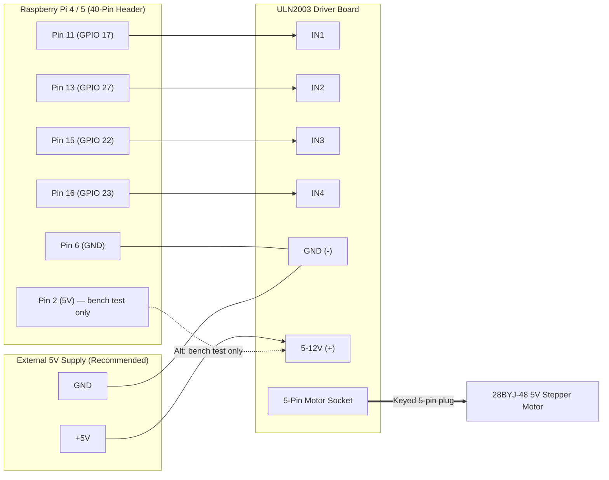

# ULN2003 Stepper Driver & Raspberry Pi GPIO Wiring Guide

This guide documents the **solderless** wiring between a **Raspberry Pi 4 / 5** (40-pin GPIO header) and a **ULN2003 stepper driver board** driving the **28BYJ-48 5V** stepper motor used for film transport.

---

## Parts Needed
- Raspberry Pi 4 (4GB) or Raspberry Pi 5 (4GB)
- 28BYJ-48 5V 4-phase unipolar stepper motor (with 5-pin JST-XH plug)
- ULN2003 driver breakout board
- 6× Female-to-Female DuPont jumper wires
- *(Recommended)* Dedicated 5V / ≥1A DC power supply (e.g., USB breakout or bench supply) for the ULN2003 board

---

## Pinout Mapping

The default pin assignment matches `src/scanner.py` (`--pins 17,27,22,23`):

| ULN2003 Pin | Raspberry Pi BCM | Raspberry Pi Physical Pin | Suggested Wire Color | Function |
| :--- | :--- | :--- | :--- | :--- |
| `IN1` | **GPIO 17** | **Pin 11** | Blue | Coil phase A |
| `IN2` | **GPIO 27** | **Pin 13** | Green | Coil phase B |
| `IN3` | **GPIO 22** | **Pin 15** | Yellow | Coil phase C |
| `IN4` | **GPIO 23** | **Pin 16** | Orange | Coil phase D |
| `5-12V (+)` | *(External 5V+)* or **5V** | *(External)* or **Pin 2 / 4** | Red | Motor power (+5V) |
| `GND (-)` | **GND** | **Pin 6** (or **Pin 9 / 14**) | Black | Common ground |

> **Important (Power & Common Ground):**
> - **Bench testing:** You can power the ULN2003 directly from Raspberry Pi **Pin 2 or Pin 4 (5V)** and **Pin 6 (GND)** for short tests without an SSD attached.
> - **Full scanning (recommended):** Because the Raspberry Pi is simultaneously powering the HQ Camera and an external USB 3.0 SSD, power the ULN2003 `5-12V (+)` and `(-)` pins from a **separate 5V supply** to avoid undervoltage brownouts or USB resets. When using an external supply, you **must still connect ULN2003 `GND (-)` to Raspberry Pi `GND` (Pin 6)** so the GPIO logic signals share a common ground reference.
> - **ULN2003 Power Jumper:** Confirm the small 2-pin plastic jumper cap next to the `5-12V` power header on the ULN2003 board is **installed** (closed). Without it, +5V does not reach the stepper motor's common wire.

---

## Wiring Diagram



### Raspberry Pi 40-Pin Header Reference (Pins 1–16)

```text
          3.3V  [ 1] [ 2]  5V  (bench test only)
         GPIO2  [ 3] [ 4]  5V
         GPIO3  [ 5] [ 6]  GND  ---> ULN2003 GND (-) [+ External 5V GND]
         GPIO4  [ 7] [ 8]  GPIO14
           GND  [ 9] [10]  GPIO15
IN1 <--- GPIO17 [11] [12]  GPIO18
IN2 <--- GPIO27 [13] [14]  GND
IN3 <--- GPIO22 [15] [16]  GPIO23 ---> IN4
```

---

## Motor Connection & Mechanics Notes
1. **5-Pin Motor Plug:** Plug the 28BYJ-48's white 5-pin JST-XH connector into the matching socket on the ULN2003 board. It is keyed and only fits one way.
2. **Half-Step Resolution:** `src/scanner.py` drives the 28BYJ-48 in **8-phase half-step mode** (~4096 half-steps per output shaft revolution). Combined with the Technic worm gear + 24-tooth gear (24:1 reduction), this yields extremely fine linear film positioning and high holding friction even when the coils are de-energized.
3. **Coil De-energizing:** Because the worm gear is self-locking, `src/scanner.py` releases (powers off) all four ULN2003 coils right before capturing each frame. This eliminates motor heating and holding-torque micro-vibrations.
4. **Direction Reversal:** If the rubber rollers advance the film in the wrong direction, you do **not** need to rewire—pass `--reverse` to `src/scanner.py`.

---

## Quick Verification on Raspberry Pi

Install dependencies on Raspberry Pi OS (Bookworm or newer, works on both Pi 4 and Pi 5):

```bash
sudo apt update
sudo apt install -y python3-gpiozero python3-lgpio python3-picamera2 python3-opencv
```

Run a quick quarter-turn bench test (disconnect the film first) and verify the four onboard LEDs (`A`, `B`, `C`, `D`) on the ULN2003 board cycle smoothly in sequence:

```bash
python3 -c "
import time
from gpiozero import OutputDevice

pins = [OutputDevice(p) for p in (17, 27, 22, 23)]
seq = [
    (1,0,0,0), (1,1,0,0), (0,1,0,0), (0,1,1,0),
    (0,0,1,0), (0,0,1,1), (0,0,0,1), (1,0,0,1),
]
try:
    for i in range(1024):  # ~90 degrees on 28BYJ-48 output shaft
        for pin, val in zip(pins, seq[i % 8]):
            pin.value = val
        time.sleep(0.002)
finally:
    for pin in pins:
        pin.off()
        pin.close()
"
```

### Troubleshooting
- **LEDs blink, motor vibrates but doesn't spin:** Check that `IN1–IN4` are wired in the exact order `17, 27, 22, 23`, and verify the 5V supply can deliver at least 300 mA.
- **No LEDs light up:** Confirm `GND` is connected to Raspberry Pi Pin 6 and the ULN2003 power jumper cap is seated.
- **`lgpio` / GPIO permission error on Pi 5:** Ensure your user is in the `gpio` group (`sudo usermod -aG gpio $USER`) and reboot/re-login.
